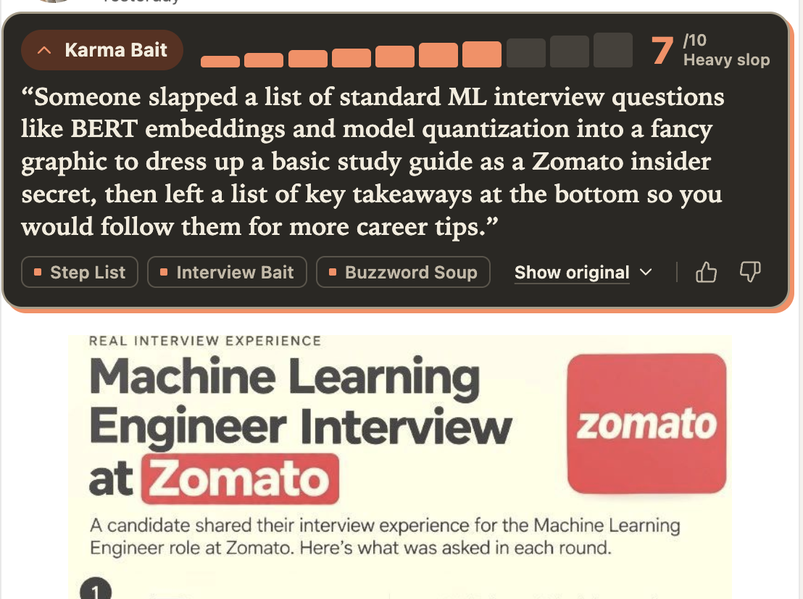
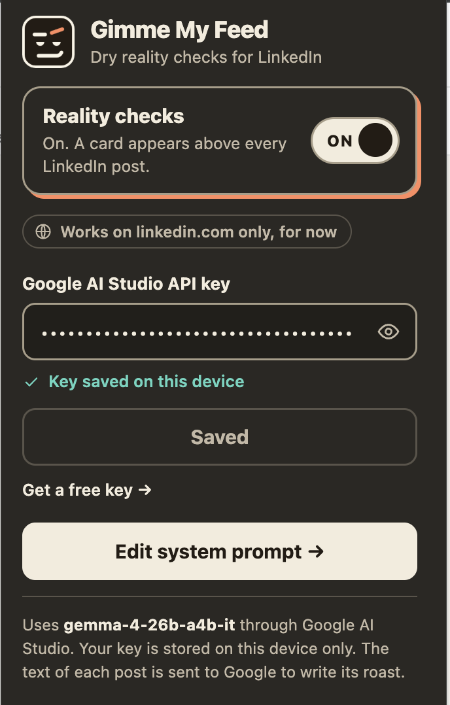

# Gimme My Feed

A Chrome extension that puts a dry reality check above every LinkedIn post. Powered by **gemma-4-26b-a4b-it** via Google AI Studio.



---

## What it does

For every post in your LinkedIn feed, the extension injects a card that shows:

- **Archetype** — what kind of post this is (Karma Bait, Humble Brag, Thought Leader, etc.)
- **Slop meter** — a 1–10 score for how much bigger the packaging is than the content
- **One-line roast** — a blunt rewrite of what the post is actually saying
- **Trick tags** — the specific tactics used (Step List, Interview Bait, Buzzword Soup, …)
- **Show original** toggle to read the source post inline
- Promoted posts are hidden automatically

---

## Setup

1. Clone the repo and install dependencies:
   ```bash
   npm install
   ```

2. Build the extension:
   ```bash
   npm run build
   ```

3. Load it in Chrome: open `chrome://extensions`, enable **Developer mode**, click **Load unpacked**, and select `.output/chrome-mv3/`.

4. Get a free API key from [Google AI Studio](https://aistudio.google.com/apikey) and paste it into the extension popup.



---

## Development

```bash
npm run dev       # Hot-reload dev build for Chrome
npm run compile   # Type-check only
npm run zip       # Production build + zip for store submission
```

---

## Tech

- [WXT](https://wxt.dev/) — Vite-based browser extension framework
- React 19 + Tailwind CSS v4
- Google Generative AI (`gemma-4-26b-a4b-it` via `v1beta` API)
- Shadow DOM isolation so styles never bleed into LinkedIn's page

---

## Privacy

Your API key is stored locally in `chrome.storage.local` and never leaves your device. Post text is sent to Google's Generative Language API to generate the roast. No data is collected or stored by this extension.
